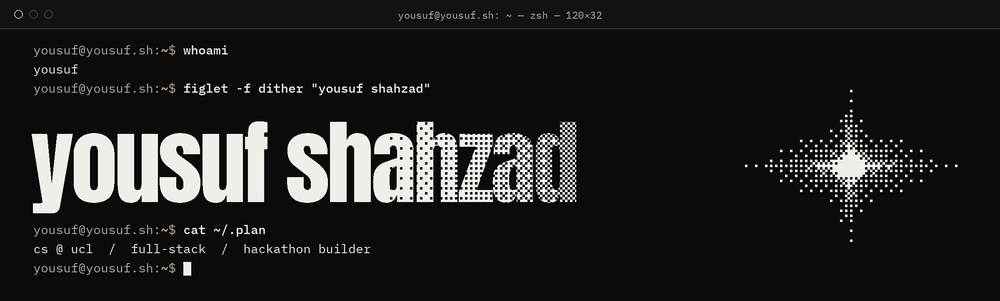

First-year **Computer Science** student at **UCL**, based in London 🇬🇧.

I build full-stack apps and tools that use AI carefully: the model helps, but the rules, the evidence and the final call stay checkable. Most of my recent work comes out of hackathons and build challenges.

- 🎓 BSc Computer Science @ UCL, graduating 2029
- 🏆 A* in Maths, Further Maths and Computer Science at A-level, plus an A* EPQ on AES-256
- 💼 Looking for **software spring weeks and summer 2027 internships**. Get in touch at [contact@yousuf.sh](mailto:contact@yousuf.sh)

## 🏆 Competitions

- 🥈 **Lockheed Martin Code Quest**: 2nd place (2025)
- 🏅 **Accel AI Innovate London**: 6th of 42 teams (2026)
- 📐 **SIAM MathWorks M3 Challenge**: reached the second round, top 18%

## 🛠️ Tech Stack

### Languages

### Web Development

### Databases & Infrastructure

### Development Tools

